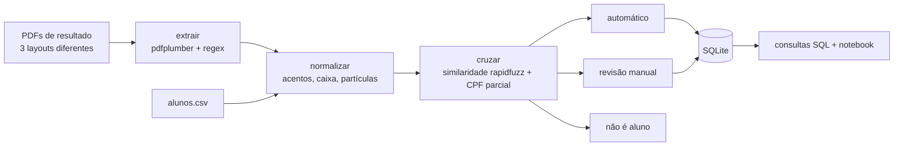
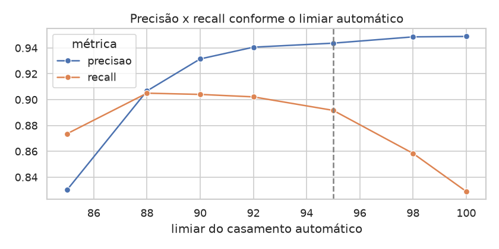
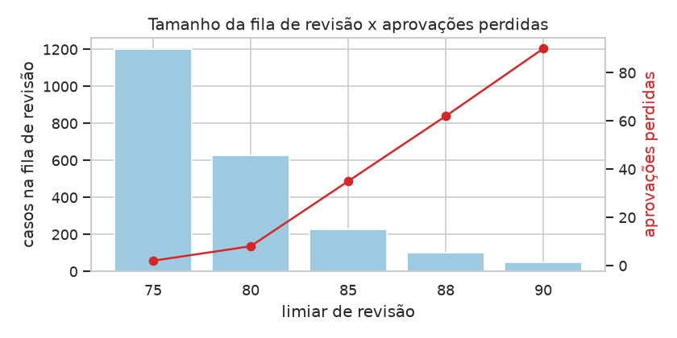
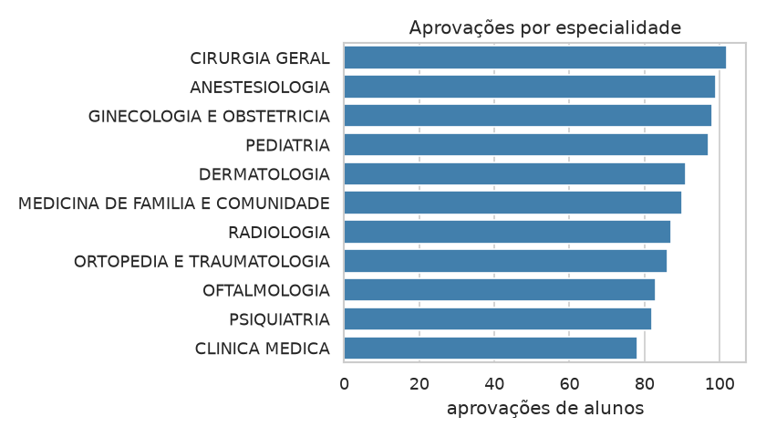

# Apuração de aprovados em residência médica

> Dados 100% sintéticos: instituições, candidatos e alunos são inventados.

Projeto de estudo que simula uma tarefa comum em cursinhos preparatórios: quando saem os
resultados das provas de residência, descobrir **quais alunos do cursinho foram aprovados, onde e
em qual especialidade**.

O trabalho difícil não é contar, e sim **ligar o nome publicado no PDF ao aluno certo da base**. Os
nomes nunca vêm iguais: a lista sai em maiúsculas e sem acento, o aluno se cadastrou como
"ana c. souza", alguém digitou "Feranda", e existem homônimos.

## Fluxo



## Como rodar

Precisa do [uv](https://docs.astral.sh/uv/) instalado.

```bash
uv sync                                       # instala as dependências
uv run python scripts/gerar_dados.py          # gera os PDFs, a base de alunos e o gabarito
uv run python -m apuracao_aprovados.main      # extrai, cruza e grava em data/processed/
uv run pytest -q                              # roda os testes
```

A análise está em [`notebooks/analise.ipynb`](notebooks/analise.ipynb), que já está executado.

## Estrutura

```
scripts/gerar_dados.py          gera os dados sintéticos (seed fixa)
data/raw/                       os 3 PDFs de resultado e alunos.csv
data/gabarito/gabarito.csv      a resposta certa do cruzamento (só existe por serem dados sintéticos)
data/processed/                 resultado_cruzamento.csv e revisao_manual.csv (o .sqlite é gerado)
src/apuracao_aprovados/
    extrair.py                  uma função por layout de PDF
    normalizar.py               padronização de nomes e especialidades
    cruzar.py                   casamento por similaridade e avaliação contra o gabarito
    banco.py                    gravação em SQLite e leitura das consultas
    main.py                     roda tudo
sql/schema.sql, sql/consultas.sql
notebooks/analise.ipynb
tests/
```

## Os três PDFs

| Instituição (fictícia) | Layout | Dificuldade |
|---|---|---|
| IRP | tabela, nomes em maiúsculas sem acento | nomes longos quebram em duas linhas |
| ENU | texto corrido, agrupado por especialidade | não é tabela: precisa de regex, ignorando cabeçalho e rodapé |
| HES | tabela com CPF mascarado (`***.123.456-**`) | mistura aprovados e lista de espera |

## Como o cruzamento decide

1. Os nomes dos dois lados são normalizados: sem acento, minúsculos, sem "de/da/dos" e sem
   espaços extras.
2. Para cada aprovado, buscam-se os 3 alunos mais parecidos com `fuzz.token_sort_ratio`, que dá uma
   nota de 0 a 100 e não se importa com a ordem das palavras.
3. Com a nota em mãos:
   - **≥ 95**: casamento automático, a não ser que dois alunos diferentes tenham nota alta
     (homônimos). Nesse caso, o nome vai para a revisão;
   - **entre 85 e 95**: revisão manual (`data/processed/revisao_manual.csv`);
   - **< 85**: não é aluno.
4. Quando a lista tem CPF parcial (HES), a busca é feita só entre os alunos com aquele CPF. Nesse
   caso, nome com nota ≥ 85 e CPF igual já é casamento automático, sem passar pela revisão.

Na revisão, o arquivo `revisao_manual.csv` mostra os alunos candidatos com as notas (coluna
`candidatos`), para que quem confere veja, por exemplo, os dois homônimos.

Os limiares não foram chutados: o notebook testa vários valores contra o gabarito. Como a escolha e
a medição usam o mesmo gabarito, os números abaixo são um pouco otimistas. Entre 92 e 95 a precisão
quase não muda, e o 95 vem de um critério de negócio (errar um aprovado é pior que revisar a mais).



## Resultados

| | |
|---|---|
| Nomes extraídos dos 3 PDFs | 3.258 (todos, conferido com o gabarito) |
| Casamentos automáticos | 993, com **94,4% de precisão** |
| Aprovações de alunos encontradas sem ajuda (recall) | **89,1%** |
| Fila de revisão manual | 227 casos |
| Aprovações de alunos perdidas | 35 |
| Alunos distintos aprovados | 830 (inclui os até 54 casamentos errados, então é uma estimativa para cima) |

As contas são por aprovação: um aluno aprovado em três instituições conta três vezes.

**Principal aprendizado:** quase todos os erros do automático (54 de 56) são **homônimos de fora**,
ou seja, candidatos que não são alunos mas têm exatamente o nome de um aluno. Pelo nome não há como
separar os dois. No HES, onde há CPF parcial, esse erro não acontece. Na prática, vale usar qualquer
identificador que a lista publique, ou pedir que o aluno confirme a aprovação.

**Escolha consciente:** subir o limiar de revisão de 80 para 85 reduz a fila de 629 para 227 casos
e perde 27 aprovações de alunos a mais. Num período de pico, uma fila administrável é o que permite entregar no
prazo. O notebook mostra essa troca.



## Consultas SQL

[`sql/consultas.sql`](sql/consultas.sql) responde a 7 perguntas: o resumo da apuração, a
participação do cursinho em cada lista, as aprovações por especialidade, a taxa de aprovação por
turma (`LEFT JOIN`), os alunos aprovados em mais de uma instituição (`HAVING`), a melhor
classificação de cada aluno (`ROW_NUMBER`, sem o HES, que não publica classificação) e a fila de
revisão por motivo.



## Limitações

- Os dados são sintéticos. Listas reais trazem problemas que não simulei: PDFs escaneados (exigiriam
  OCR), nome social, sobrenome trocado após casamento e layout que muda de um ano para outro.
- As diferenças entre turmas e especialidades não significam nada: a aprovação foi sorteada com a
  mesma chance para todos.
- `token_sort_ratio` é uma medida simples. Um próximo passo seria combinar medidas ou dar mais peso
  ao primeiro e ao último nome.

## Autor

Luccas Nunes · [github.com/luccas-data](https://github.com/luccas-data)
